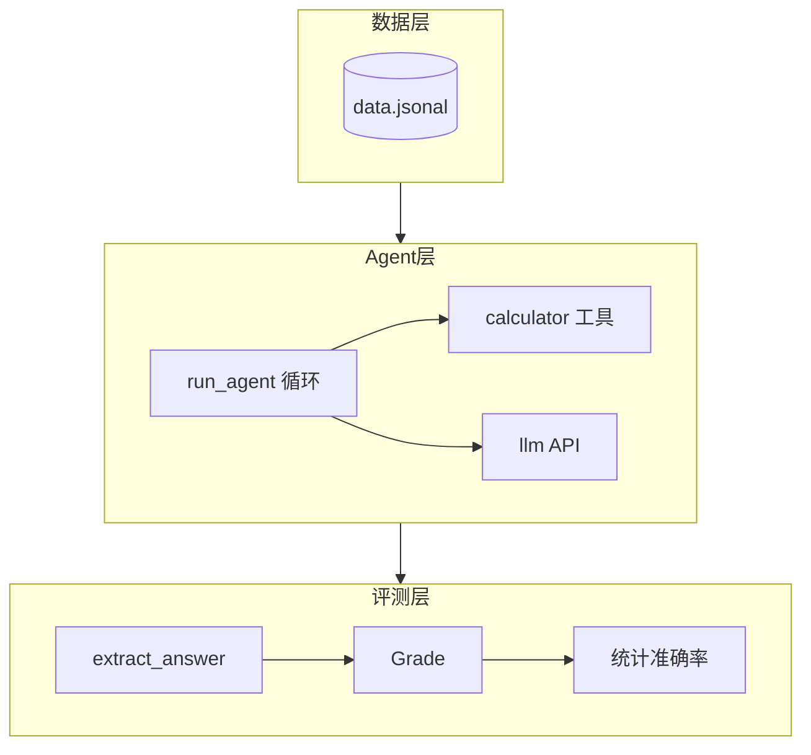

# Agent-Eval

> 一个从0开始搭建的最小的Agent的评测框架：让带工具的Claude解答数学题，并自动打分

## 目录
- [核心概念]
- [架构]

---

## 核心概念

Agent eval用于系统化地衡量agent的表现，代替靠感觉判断“好像能用”。

### 三个组成部分
| 组成 | 作用 | 本项目实现 |
|---|---|---|
|数据集|题目 + 标准答案|`data.jsonl`|
|被测agent| llm + 工具 + 循环 |`agent.py`|
|评分器| 判断输出是否正确|`run_eval.py`中的`grade()`|

### 与普通llm eval的区别

- **普通llm eval**: 只看最终答案
- **Agent eval**: 同时看 **结果** 和 **过程**
  - 结果: 答案对不对
  - 过程: 调用了哪些函数

---

## 架构

### 分层结构
